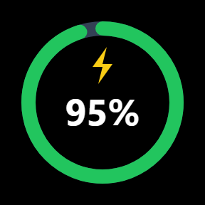
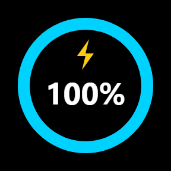
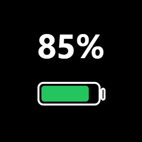
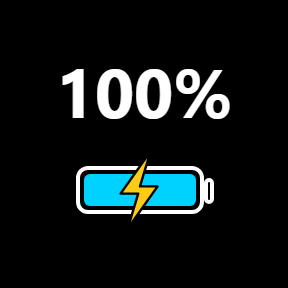
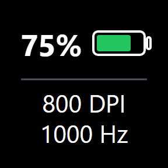
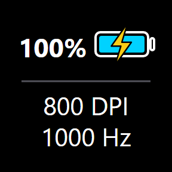
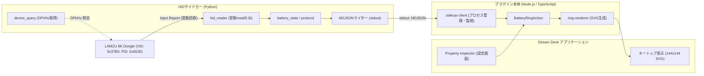

# ThornV2 Battery Monitor (Stream Deck プラグイン)

LAMZU Thorn V2 ワイヤレスゲーミングマウス（LAMZU 8K Dongle V2 経由）のバッテリー残量・充電状態・接続状態・DPI / ポーリングレートを、Elgato Stream Deck のキー上にリアルタイム表示するプラグインです。

---

## 主な機能と表示デザイン

Property Inspector（設定画面）から、好みに応じた3種類の表示デザインを選択できます。

| デザイン | 通常時 | 充電中<br>(⚡) | 充電完了<br>(⚡) | 特徴 |
| :---: | :---: | :---: | :---: | :--- |
| **Ring** |  |  |  | 円形リングゲージ ＋ 白文字（`95%`）。充電中・充電完了時は上部に⚡マークを表示。 |
| **Icon** |  |  |  | 電池アイコン ＋ 白文字（`85%`）。充電中・充電完了時は中央に薄い黒縁取りの⚡マークを表示。 |
| **Icon +<br>DPI/Hz** |  |  |  | 上段にバッテリー残量＆小型電池、下段に現在の `800 DPI` / `1000 Hz` を同時表示。 |

### ステータスごとの表示変化
- **通常動作**: 残量に応じてカラーが変化（51–100%: 緑 `#22c55e`、21–50%: 黄 `#eab308`、0–20%: 赤 `#ef4444`）
- **充電中**: バッテリー残量色を維持したまま、稲妻マーク（⚡）を重畳表示
- **充電完了**: ゲージ色をシアン（`#00d2ff`）に変化させ、稲妻マーク（⚡）を重畳表示
- **スリープ推測**: マウス操作が15秒間途絶えた場合、減衰表示 + `zz` バッジ表示
- **待機中 / 初期化中**: 暗灰色ゲージ + `--` 表示
- **ドングル切断**: 暗灰色ゲージ + `N/A` + 切断アイコン
- **通信エラー / 再起動中**: 赤破線ゲージ + `ERR` 表示

---

## 設定項目 (Property Inspector)

Stream Deck アプリでキーをクリックすると、以下の設定を変更できます。

1. **Design（表示デザイン）**:
   - `Ring`（円形ゲージ）
   - `Icon`（電池アイコン）
   - `Icon + DPI / Hz`（電池アイコン ＋ DPI / ポーリングレート）
2. **Device Query Interval (seconds)**:
   - 「Icon + DPI / Hz」選択時のみ有効。DPIおよびポーリングレートを取得・更新する間隔を秒単位で指定します（初期値: 30秒、範囲: 5〜3600秒）。

---

## インストール方法

1. **[Releases ページ](https://github.com/jun0b/LAMZU-Thorn-V2-Battery-Monitor-StreamDeck/releases/latest)** から最新の `com.jun0b.thornv2-battery-monitor.streamDeckPlugin` をダウンロードし、ダブルクリックします（または自前でビルドしたパッケージを使用）。
2. Stream Deck アプリケーションにプラグインが自動登録されます。
3. Stream Deck アプリ右側のアクション一覧（「ThornV2 Battery Monitor」カテゴリ）から「**ThornV2 Battery Monitor**」を任意のキーへドラッグ＆ドロップして配置します。

---

## アーキテクチャ

プラグイン本体（TypeScript / Node.js, Stream Deck SDK v6）と、USB HID 受信を担う Python サイドカー（PyInstaller `--console --onedir` 形式）が、標準入出力（stdio）を介した UTF-8 NDJSON プロトコルで安全に連携します。



### 安全性と信頼性
- **完全受動型バッテリー監視**: 通常のバッテリー監視は Input Report の受動受信（`read`）のみを行い、デバイスへの不要な書き込みは行いません。
- **ゾンビプロセス防止**: Stream Deck アプリ終了時やクラッシュ時、パイプの EOF を検知してサイドカーが自律的に 2.5 秒以内に正常終了（Exit Code: 0）します。
- **軽量描画**: 前フレームと描画内容が一致する場合は `setImage` をスキップし、CPU・USB 負荷を最小限に抑えます。

詳細な通信電文仕様は [docs/IPC_PROTOCOL.md](docs/IPC_PROTOCOL.md) を参照してください。

---

## 開発・ビルド手順

### 前提環境
- Windows 10 / 11
- Node.js 20 以上
- Python 3.10 以上

### ビルドコマンド
```powershell
# 依存パッケージのインストール
npm install
python -m venv .venv
.\.venv\Scripts\pip install -r sidecar/requirements.txt

# プラグイン (TypeScript) のビルド
npm run build

# サイドカー (EXE) のビルド
powershell -ExecutionPolicy Bypass -File scripts/build-sidecar.ps1

# 配布用パッケージ (.streamDeckPlugin) の作成
powershell -ExecutionPolicy Bypass -File scripts/pack.ps1
```

---

## ライセンス

MIT License
