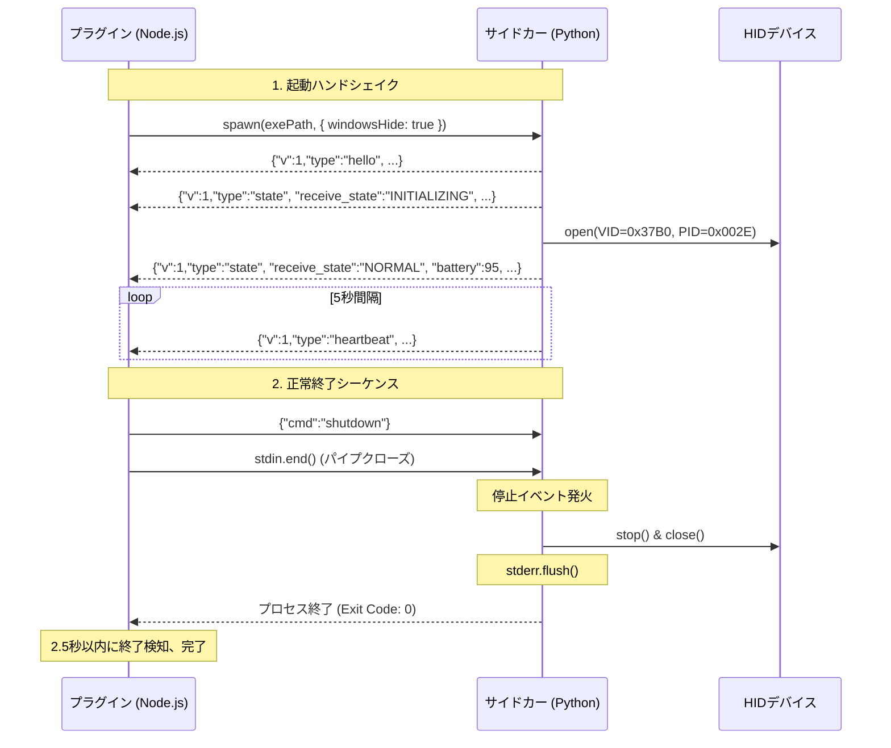

# ThornV2 Battery Monitor — IPC プロトコル仕様書 (v1)

本ドキュメントは、Stream Deck プラグイン（Node.js / TypeScript）と Python HID 受信サイドカー（PyInstaller `--console --onedir` 形式）の間で行われるプロセス間通信（IPC: Inter-Process Communication）の完全なプロトコル仕様を定義します。

---

## 1. 概要とアーキテクチャ

### 1.1 通信方式
- **トランスポート層**: 標準入出力パイプ（Standard I/O Streams: `stdin` / `stdout` / `stderr`）
- **プロセス起動**: Node.js 側の `child_process.spawn` を使用
  - `windowsHide: true`（Windows 環境においてコンソール黒画面を完全非表示化）
  - `stdio: ['pipe', 'pipe', 'pipe']`（全ストリームを個別パイプで制御）
- **サイドカービルド方式**:
  - PyInstaller `--console --onedir` 形式を採用。
  - ※ `--noconsole` は Windows 環境で `sys.stdin` / `sys.stdout` が無効化され、標準ストリーム通信がクラッシュするため**厳禁**。
  - 生成される主実行ファイル `thornv2-sidecar.exe` および依存リソース一式（`_internal/` ディレクトリ）はプラグイン配布パッケージ `com.jun0b.thornv2-battery-monitor.sdPlugin/bin/sidecar/` に同梱配置される。
- **プロセスの一意性**:
  - Stream Deck 上に複数個のキートップアクションが配置されている場合であっても、プラグインインスタンス内で単一の共有サイドカープロセスを維持管理する。

### 1.2 ストリーム分離の原則
- **`stdout`（サイドカー → プラグイン）**:
  - **NDJSON 通信専用**。スレッドセーフな単一ライター関数（`emit_ndjson`）のみが書き込みを行い、毎行即時フラッシュ（`flush=True`）を実施する。
- **`stderr`（サイドカー → プラグイン）**:
  - **診断ログ専用**。Python 標準の `logging` モジュールおよび例外トレースバックはすべて `sys.stderr` に出力し、`stdout` に一切混入させない。
- **`stdin`（プラグイン → サイドカー）**:
  - **制御コマンド専用**。プラグインからサイドカーへのコマンド送信および接続維持監視用。

---

## 2. 電文フォーマット規約

### 2.1 NDJSON（Newline Delimited JSON）
- 文字エンコーディング: **UTF-8**
- 改行コード: `\n`（LF）または `\r\n`（CRLF）※受信側は両方を許容
- 1行につき単一の完結した JSON オブジェクトを出力する。

### 2.2 防御的パースと行長制限
- **最大行長制限**: **64 KB（65,536 バイト）**
  - 不正電文やバッファ枯渇攻撃を防ぐため、1行が 64KB を超過した場合は即座に破棄し、エラーログを記録する。
- **防御的パース（Defensive Parsing）**:
  - 未知の `type`、未知のフィールド、バージョン不一致（`v !== 1`）を含むメッセージを受信しても例外クラッシュさせず、単に無視または警告ログを出力して処理を継続する。
  - JSON パースエラーが発生した行は破棄し、エラーログを `stderr` / プラグインロガーへ記録する。

---

## 3. メッセージスキーマ（サイドカー `stdout` → プラグイン）

すべてのサイドカー発信電文は、ルート直下にプロトコルバージョン `v: 1` を含みます。

### 3.1 `hello`（起動ハンドシェイク）
サイドカー起動完了時に、標準出力へ**必ず最初に1度だけ**送信されます。

```json
{
  "v": 1,
  "type": "hello",
  "pid": 1234,
  "version": "0.1.0",
  "mode": "hid"
}
```

| フィールド | 型 | 必須 | 説明 |
| :--- | :--- | :--- | :--- |
| `v` | integer | ○ | プロトコルバージョン（固定値 `1`） |
| `type` | string | ○ | 固定値 `"hello"` |
| `pid` | integer | ○ | サイドカープロセスの OS プロセス ID |
| `version` | string | ○ | サイドカーのバージョン（例: `"0.1.0"`） |
| `mode` | string | ○ | 動作モード（`"hid"`: 通常実機モード, `"demo"`: 自動デモサイクルモード） |

---

### 3.2 `state`（状態スナップショット）
以下のタイミングで送信されます:
1. `hello` 送信直後（初期状態スナップショット）
2. HID 受信やタイムアウトによる状態変化の発生時
3. プラグインから `{"cmd":"get_state"}` を受信した時の応答

```json
{
  "v": 1,
  "type": "state",
  "receive_state": "NORMAL",
  "battery": 87,
  "charging": "CHARGING",
  "dpi": 800,
  "polling_rate": 1000,
  "ts": 1792240001.0
}
```

| フィールド | 型 | 必須 | 説明 |
| :--- | :--- | :--- | :--- |
| `v` | integer | ○ | プロトコルバージョン（固定値 `1`） |
| `type` | string | ○ | 固定値 `"state"` |
| `receive_state` | string | ○ | バッテリー受信ステータス（下記参照） |
| `battery` | integer \| null | ○ | バッテリー残量パーセント（`0` 〜 `100`、未取得時は `null`） |
| `charging` | string | ○ | 充電ステータス（`"UNKNOWN"`, `"DISCHARGING"`, `"CHARGING"`） |
| `dpi` | integer \| null | - | 現在の DPI 設定値（未取得時は `null`） |
| `polling_rate` | integer \| null | - | 現在のポーリングレート（Hz、未取得時は `null`） |
| `ts` | number | ○ | 状態更新時刻の UNIX タイムスタンプ（秒、浮動小数点数） |

#### `receive_state` の値定義:
- `"INITIALIZING"`: サイドカー起動直後、デバイスオープン前
- `"WAITING_DATA"`: ドングルオープン成功、最初の有効パケット待機中
- `"NORMAL"`: 有効なバッテリー情報を受信中
- `"SLEEP_SUSPECTED"`: 最後の有効な Format A (`0x38`) パケット受信から 15秒以上経過（スリープ推測状態）
- `"DONGLE_DISCONNECTED"`: ドングル未接続、抜去、または HID 通信切断

#### ハードウェア仕様に基づく充電ステータスの扱い:
- マウス本体および LAMZU 8K ドングルの仕様上、USB ケーブル抜去後もハードウェア側から充電中ステータスが継続送信される場合がある。
- **サイドカー側で推測によるステータス上書きや強制解除は行わず、デバイスから受信した値を忠実に伝達する**（`HID_PROTOCOL.md` 準拠）。

---

### 3.3 `heartbeat`（生存確認）
サイドカーから **5.0秒間隔** で定期送信されます。

```json
{
  "v": 1,
  "type": "heartbeat",
  "ts": 1792240005.0
}
```

| フィールド | 型 | 必須 | 説明 |
| :--- | :--- | :--- | :--- |
| `v` | integer | ○ | プロトコルバージョン（固定値 `1`） |
| `type` | string | ○ | 固定値 `"heartbeat"` |
| `ts` | number | ○ | 送信時刻の UNIX タイムスタンプ（秒） |

- **ハートビートタイムアウト**: プラグイン側は、前回の電文（`state` または `heartbeat`）受信から **15.0秒** が経過した場合、サイドカーのフリーズまたは異常終了と判定し、再起動シーケンスへ移行する。

---

## 4. コマンドスキーマ（プラグイン `stdin` → サイドカー）

### 4.1 `get_state`（状態取得要求）
現在の完全なバッテリー状態スナップショットの即時再送を要求します。

```json
{"cmd":"get_state"}
```

### 4.2 `query_device`（デバイス設定照会要求）
マウスの現在の DPI 設定およびポーリングレート（Hz）の照会を非同期で要求します。取得結果は次回の `state` メッセージ（`dpi`, `polling_rate` フィールド）に反映されます。

```json
{"cmd":"query_device"}
```

### 4.3 `shutdown`（正常終了要求）
サイドカーに対してクリーンアップと正常終了を要求します。

```json
{"cmd":"shutdown"}
```

---

## 5. プロセスライフサイクルとグレースフルシャットダウン



### 5.1 正常終了シーケンス（Graceful Shutdown）
1. プラグイン終了時、プラグインはサイドカーへ `{"cmd":"shutdown"}` を書き込み、`stdin.end()` でパイプを閉じる。
2. サイドカーの stdin 監視スレッドが `shutdown` コマンドまたは EOF（パイプ切断）を検知する。
3. サイドカーは内部停止イベント（`threading.Event`）をセットする。
4. HID 受信ワーカーの `stop(timeout=2.0)` を呼び出し、リードタイムアウト（最大0.5秒）を待機して受動受信スレッドを安全に終了する。
5. HID デバイスハンドルを確実に close して解放する。
6. `sys.stderr.flush()` を実行し、未出力ログを完全に書き出す。
7. `sys.exit(0)` により正常終了する。
8. **フォールバック保証**:
   - HID スタック等のフリーズによりクリーンアップが **2.5秒** 以内に完了しない場合、サイドカー内部のフォールバックタイマーが `os._exit(1)` を呼び出して強制終了する。
   - プラグイン側も **2.5秒** 経過してもサイドカープロセスが終了しない場合、`child.kill()` により強制終了する。

### 5.2 親プロセス異常終了時の自己終了（ゾンビプロセス防止保証）
- Stream Deck アプリケーションがタスクマネージャー等で強制終了された場合、または Node.js プロセスが予期せずクラッシュした場合、Windows OS により子プロセスの標準入力パイプ（`sys.stdin`）が自動的にクローズ（EOF）される。
- サイドカーの stdin 監視スレッドは `sys.stdin.readline()` の空文字返却（EOF）を即時に検知し、上記 5.1 と全く同様のクリーンアップ手順を開始して **2.5秒以内に自己終了** する。
- これにより、孤児プロセス（ゾンビプロセス）がバックグラウンドに残留することを完全に防止する。

### 5.3 予期せぬクラッシュ時の自動再接続（指数バックオフ）
- サイドカープロセスが異常終了した場合、またはハートビート途絶（15秒経過）を検知した場合、プラグイン側は以下の指数バックオフ間隔でサイドカーの再起動を試みる:
  - 試行間隔: `1秒` → `2秒` → `4秒` → `8秒` → `16秒` → 最大 `30秒`
- 再接続待機中はキートップ表示を `ERR`（赤破線リング + `ERR`）とし、サイドカー再起動成功および `hello` / `state` 受信をもって即時に通常表示へ自動復帰する。


